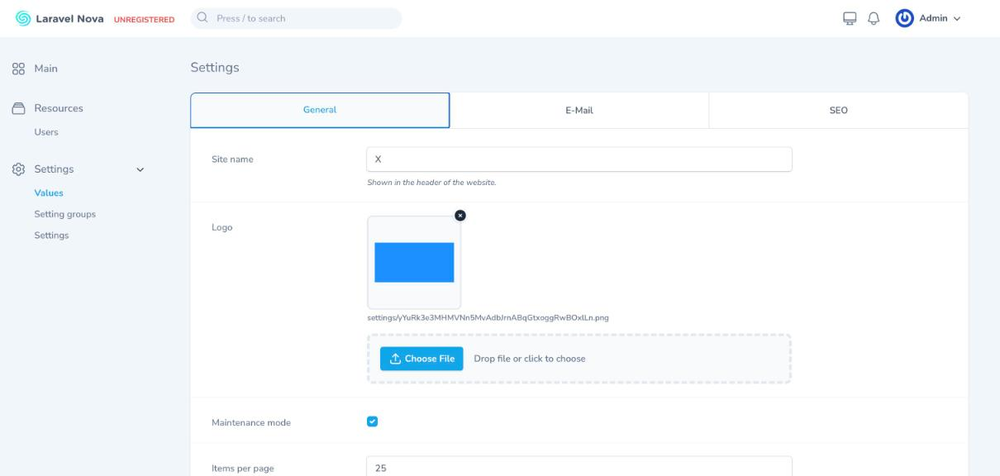

# Nova Settings

Tab-grouped, database-backed settings for **Laravel Nova 5**, built only on Nova's own
field, panel and form machinery. Every setting is a row in the `settings` table bound to
a Nova field class (Text, Number, Boolean, Select, Image, KeyValue, Code, …). Settings
are grouped into tabs (`setting_groups`), edited together on one **Settings** tool page,
and defined either **in code** (with real Nova fields and the full field API) or **from
the Nova UI** (pick a field type from a dropdown; choice-based types get a choices table).



## Requirements

- PHP 8.2+
- Laravel 11, 12 or 13
- Laravel Nova 5

## Installation

```bash
composer require lucacermenati/nova-settings
php artisan migrate
```

Register the tool in `app/Providers/NovaServiceProvider.php`:

```php
use LucaCermenati\NovaSettings\NovaSettings;

public function tools(): array
{
    return [
        NovaSettings::make(),
    ];
}
```

That is all: the sidebar gets a collapsible **Settings** section with **Values** (the
tabbed form), **Setting groups** and **Settings** (the definition resources).

Optionally publish the config:

```bash
php artisan vendor:publish --tag=nova-settings-config
```

## Defining settings in code

Anywhere in a service provider (typically `NovaServiceProvider::boot()`):

```php
use Laravel\Nova\Fields\Boolean;
use Laravel\Nova\Fields\Image;
use Laravel\Nova\Fields\Number;
use Laravel\Nova\Fields\Select;
use Laravel\Nova\Fields\Text;
use LucaCermenati\NovaSettings\Facades\NovaSettings;

NovaSettings::group('general', 'General', fn () => [
    Text::make('Site name', 'site_name')->rules('required', 'max:120')->help('Shown in the header'),
    Image::make('Logo', 'logo')->disk('public')->path('settings')->prunable(),
    Boolean::make('Maintenance mode', 'maintenance_mode'),
    Number::make('Items per page', 'items_per_page')->min(1)->max(100)->default(25),
    Select::make('Locale', 'locale')->options(['en' => 'English', 'nl' => 'Dutch'])->displayUsingLabels(),
])->icon('cog-6-tooth')->order(1);

NovaSettings::group('mail', 'E-mail', fn () => [
    Email::make('From address', 'mail_from')->rules('required', 'email'),
]);
```

- The field **attribute is the setting key** (`setting('site_name')`).
- Everything Nova allows on a field works: rules, help, placeholder, defaults,
  `fillUsing`, `storeAs`, `prunable`, `readonly`, custom field classes, …
- Pass a closure (recommended) so fields are built fresh on every request.
- Code definitions are **synced into the database** automatically the first time Nova is
  served after they change (`auto_sync`), or with `php artisan nova-settings:sync`.
  Synced rows are marked *Defined in code* and are read-only in the resources.
  Values are never touched by a sync.
- When you remove a field from code, its row is kept (and becomes editable/deletable in
  the UI) until you run `php artisan nova-settings:sync --prune`.

## Defining settings from the Nova UI

Open **Settings → Setting groups** to create a tab, then **Settings → Settings** to add a
setting: choose the group, a key, a label and the **field type** (dropdown, see
`field_types` in the config). When the type is Select, Multi select or Boolean group a
**Choices** table appears (value → label) and at least one row is required; no other type
needs anything else. Defaults, placeholders, validation rules, limits and the like are a
code-definition concern: define the setting in code with the real Nova field instead.

Rows created programmatically (`Setting::create([...])`) may still carry an `options`
array with any of the keys listed in `FieldFactory`: `help`, `placeholder`, `default`,
`rules`, `nullable`, `required`, `options`, `min`/`max`/`step`, `currency`, `rows`,
`language`/`json`, `disk`/`path`/`acceptedTypes`/`maxWidth`, `trueValue`/`falseValue`,
`keyLabel`/`valueLabel`/`actionText`.

## Reading values

```php
setting('site_name');                 // "Acme"
setting('maintenance_mode');          // true (bool)
setting('items_per_page');            // 25 (int, falls back to the field default)
setting('social_links');              // ['twitter' => '…'] (array)
setting('unknown', 'fallback');       // "fallback"
setting_url('logo');                  // https://…/storage/settings/abc.png

NovaSettings::get('site_name');
NovaSettings::set('site_name', 'Acme');   // write programmatically
NovaSettings::all();                      // key => value
NovaSettings::flushCache();
```

Values are cached forever (see `cache` in the config) and the cache is cleared whenever a
setting is saved. Values are cast according to their field class: Boolean → `bool`,
Number → `int|float`, Currency → `float`, MultiSelect / BooleanGroup / KeyValue → `array`,
Code with `json` → `array`, Date / DateTime → `Carbon`.

## Configuration

See `config/nova-settings.php`: tool label/icon/path, `manage_definitions` (register the
two resources), `auto_sync`, `cache`, default `files.disk` / `files.path`, the
`field_types` dropdown allow-list.

## Limitations

The settings page is a Nova tool, not a resource, so fields that need a resource context
are not supported there: relationship fields, `Repeater`, `Tag`, `dependsOn`, and
Trix / Markdown file attachments (`withFiles`).

## Development

```bash
composer install          # needs Nova credentials (composer config http-basic.nova.laravel.com …)
npm install && npm run dev
vendor/bin/pest
```

The compiled assets in `dist/` are committed, so host applications never need a build.

## License

MIT
